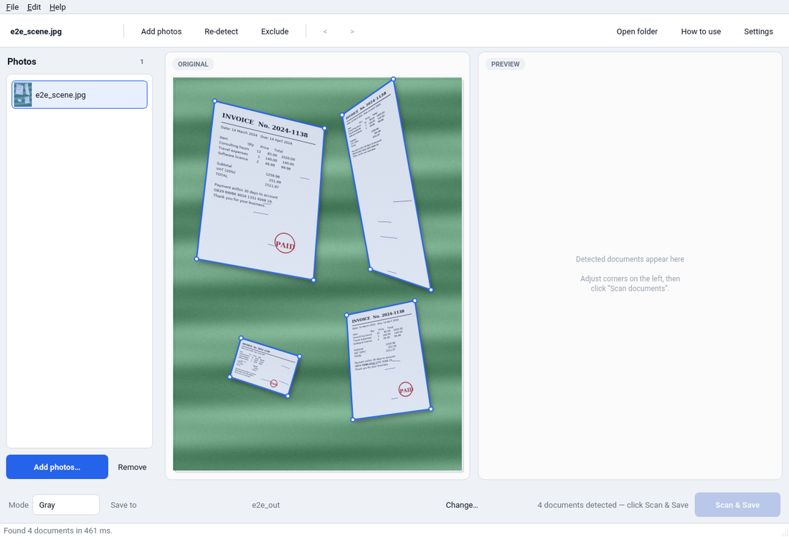

# SmartScan

Photograph several small documents at once — receipts, cards, notes, invoices — and
SmartScan finds each one, straightens it, cleans it up, and saves it to the folder you
chose. Windows desktop app (Python + PySide6 + OpenCV), installed from a normal setup
wizard.



## What it does

- **Automatic edge detection** for several documents in a single photo, including
  pages lying at an angle, overlapping slightly, or photographed in perspective.
- **Straightening and de-skewing** — every page is warped to a flat rectangle, and
  sideways pages are turned upright automatically.
- **Preview before saving** — check the outlines, nudge any corner, drop pages you do
  not want, then scan.
- **Clean-up modes** — Auto, Color, Gray, B&W and Original.
- **Saves where you told it to** — pick the output folder once; the app remembers it.
  One multi-page PDF (default) or one file per page as JPG, PNG or TIFF.

## Install (Windows)

1. Download
   [`SmartScan-Setup-1.0.0.exe`](https://github.com/idmag/smartscan/releases/download/v1.0.0/SmartScan-Setup-1.0.0.exe)
   from the [Releases](../../releases) page.
2. Run it and follow the wizard. No administrator rights are needed for a per-user
   install; Python does not need to be installed.
3. Start **SmartScan** from the Start menu or the desktop shortcut.

The installer is built by the `Build Windows installer` GitHub workflow; see
[Building](#building) to produce it yourself.

## Quick start

1. Lay the documents on a plain, evenly lit surface — a desk, a sheet of card, a dark
   mat. Avoid heavy shadows across the paper.
2. In SmartScan click **Add photos…**, drag image files onto the window, or paste a
   screenshot with **Ctrl+V**.
3. The documents are outlined in blue and previewed on the right. Drag a corner handle
   to correct an outline; press **Re-detect** (Ctrl+R) to start over.
4. Select a page thumbnail and press **E** (or **Exclude**) to drop a false detection.
5. Choose the clean-up **Mode**, check **Save to**, then click **Scan & Save** (Ctrl+S).

Files are written to the output folder with names like
`Scan_2026-11-20_14-32-05_1.pdf`. Use **Open folder** to see them.

See [HOW-TO-USE.md](HOW-TO-USE.md) for the full user guide.

## Building

Requires Python 3.10+ and, for the installer, [Inno Setup 6](https://jrsoftware.org/isinfo.php).

```bash
python -m venv .venv
.venv\Scripts\activate                 # Windows;  source .venv/bin/activate elsewhere
pip install -r requirements-dev.txt    # PySide6, OpenCV, numpy, Pillow, pytest, PyInstaller

python -m pytest                       # 39 tests, synthetic photos, no fixtures
python run_smartscan.py                # run from source

pyinstaller packaging/smartscan.spec --noconfirm   # -> dist/SmartScan/SmartScan.exe
iscc packaging/inno/smartscan.iss                  # -> dist/SmartScan-Setup-1.0.0.exe
```

(The PyInstaller build must run on Windows — it cannot cross-compile — which is why the
GitHub workflow does it on a `windows-latest` runner.)

`pyinstaller` builds `dist/SmartScan/SmartScan.exe` (one-folder build, so startup is
fast); Inno Setup wraps it into a single installer. Pushing a tag such as `v1.0.0`
runs `.github/workflows/build-windows.yml`, which produces the installer as a build
artifact and attaches it to a GitHub release.

## How it works

| Stage | Module | Idea |
| --- | --- | --- |
| Candidate masks | `app/core/detect.py` | Five independent segmentations (brightness, adaptive threshold at two scales, saturation, Canny edges). Each large contour becomes a quadrilateral. |
| Scoring | `app/core/detect.py` | A page is *convex*, has roughly parallel opposite sides, sane corner angles, and — the decisive test — real image gradients along all four of its sides. Scoring by edge support happens **before** duplicate suppression so a merged blob of two touching pages cannot swallow either of them. |
| Validation | `app/core/detect.py` | Interior must be clearly brighter than the surrounding ring (documents are bright objects on a darker surface). |
| Refinement | `app/core/detect.py` | Each side is snapped onto the strongest nearby gradient, inwards only. |
| Warp | `app/core/perspective.py` | Destination-only resize to the page's own aspect ratio, optional outward margin, automatic portrait rotation. |
| Clean-up | `app/core/enhance.py` | Gray-world white balance, CLAHE, and Otsu binarisation for B&W. |
| Saving | `app/core/scanner.py` | 300 DPI output, 1-bit PDF for B&W, multi-page combining, collision-free file names. |

## Layout

```
app/
  core/         detection, perspective warp, enhancement, settings, saving
  ui/           Qt widgets: photo list, canvas, page strip, dialogs, workers
  main.py       entry point
assets/         application icon (generated by make_icon.py)
packaging/      PyInstaller spec, Inno Setup script, Linux dev stubs
tests/          pytest suite using deterministic synthetic photos
```

## Licence

MIT.
